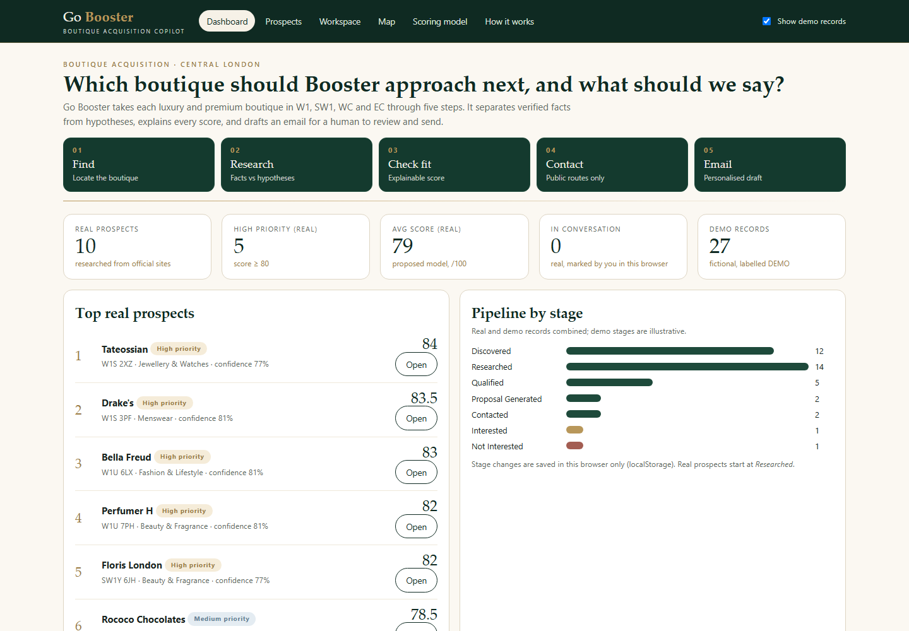

# Go Booster: Boutique Acquisition & Outreach Copilot

**Go Booster** helps Booster find, research, prioritise and contact luxury and premium boutiques in Central London
(**W1, SW1, WC, EC**). It separates verified facts from hypotheses, explains every fit score, and prepares a
personalised outreach email for a human to review and send.

> Built for the Claude x Booster Pitch Competition. Prototype only, not an official Booster product.

**Live demo:** `https://<your-github-username>.github.io/go-booster-intelligence/` *(replace once GitHub Pages is live)*



---

## The business problem
Booster grows only when a boutique says yes. Every yes starts with one well-targeted email to the right person.
Today, each prospect means hours of repetitive work: finding the shop, reading its website, judging fit, hunting for
a contact route and writing a tailored message. That effort is fragmented, hard to compare across boutiques, and
easy to get wrong, for example by relying on unverified "facts" or guessed contact details.

## The solution
A single web app that turns acquisition into one consistent, explainable workflow:

| Stage | What the user does | What Go Booster provides |
|---|---|---|
| **1. FIND** | Search and filter boutiques by area, category, priority and stage | Ranked prospect list; real and demo records always labelled |
| **2. RESEARCH** | Read the brand brief | Verified facts with source links, kept separate from hypotheses and unknowns |
| **3. CHECK FIT** | Compare and prioritise | Explainable 100-point score, per-criterion reasons, confidence, missing data |
| **4. CONTACT** | Choose the route | Public, official contact routes only; no personal names or guessed emails |
| **5. EMAIL** | Review, edit and send manually | Personalised first email and follow-up built on verified facts |

## Main features
- Dashboard with KPIs, top real prospects and pipeline by stage.
- Prospect table with search, five filters, sortable columns and CSV/JSON export.
- Prospect workspace that follows the five-stage workflow for each boutique.
- Brand intelligence where every line is tagged **FACT** (with source link), **ASSUMPTION** or **UNKNOWN**.
- Explainable scoring with live, adjustable weights (they must total 100).
- Personalised email and follow-up: copy, download as .txt, or open in your own email app.
  **Nothing is ever sent automatically.** *Mark as contacted* asks for confirmation that you sent it yourself.
- Offline schematic map positioned with real postcode coordinates.
- Stage changes, edited drafts and weights are saved in your browser (localStorage) only.
- Responsive layout for desktop and mobile.

## Explainable scoring model (proposed, not Booster's official model)

| Criterion | Weight | Inputs |
|---|---|---|
| Product suitability | 25 | Category fit for rapid delivery (e.g. leather goods 92%, home & lifestyle 48%) |
| Customer demand | 20 | Price tier (8 pts), Instagram followers (8), rating & reviews (4) |
| Geographic suitability | 20 | Priority luxury cluster 100%, W1/SW1 85%, WC 75%, EC 65%, outside 30% |
| Brand / product value | 15 | Luxury 100%, Premium 80%, Contemporary 55%, Value 30% |
| Digital readiness | 10 | Website (2), online store (5), Instagram (3) |
| Feasibility | 10 | Ownership (6), current delivery gap (4) |

- **Priority:** High ≥ 80 · Medium 60–79 · Low < 60.
- **Missing data** gets a cautious default (never zero, never full marks) and lowers **confidence**.
- **Confidence** is the weighted share of criteria backed by data (High 100%, Medium 60%, Low 25%).
- The independent research's own 5×5 rubric (out of 25) is shown next to the app score for comparison. The two
  can disagree. For example, Oliver Spencer ranks #1 in the research because it already offers phone-quoted same-day
  delivery, while the app model scores an existing same-day service as a *smaller* gap. That disagreement is shown
  openly rather than hidden.

## Evidence confidence and anti-hallucination approach
- **10 REAL prospects** come from independent public research (dated 21 Nov 2026) using official brand websites:
  store directories, delivery/FAQ pages and contact pages. Every verified fact links to its source URL.
- **Exact business names, addresses, postcodes, websites and public contact routes** are copied from that research.
  Nothing is added.
- **Positioning, fit, objections and partnership angles are labelled as hypotheses.** No brand has expressed
  interest in partnering with Booster.
- **Unknowns stay Unknown.** Examples: Instagram following, reviews, named decision-makers, some delivery terms.
  They lower the confidence score.
- **No invented contacts, statistics, commercial terms or partnerships.** Booster's own fees and SLAs are not stated.
- **27 DEMO records are fictional** and labelled *DEMO* in every view. They exist only to show how ranking works
  across a larger list. They can be hidden with the *Show demo records* toggle.
- **Human approval:** emails are drafts. A person reviews, sends and logs each one.

## Technology stack
- One self-contained `index.html`: HTML, CSS and vanilla JavaScript. No framework, no build step needed to run, no
  external requests, no API key and no backend.
- Data is embedded as JSON in the page. Map coordinates were looked up at build time from
  [postcodes.io](https://postcodes.io) (UK ONS / Ordnance Survey open data).
- Browser localStorage for per-user edits.

## How to run locally (Windows)
1. Download or clone this repository.
2. Double-click **`index.html`**. It opens in Microsoft Edge or Google Chrome. No installation or internet connection is needed.

Alternatively, serve it locally: `python -m http.server 8000`, then open `http://localhost:8000`.

## How to access the live demo
Open `https://<your-github-username>.github.io/go-booster-intelligence/` (GitHub Pages, deployed from the `main`
branch root). Replace the placeholder with your username once Pages is enabled.

## Repository structure
```
index.html                    The complete web app (self-contained)
assets/screenshots/           Screenshots of the working app
docs/PROJECT_SUMMARY.md       One-page summary
docs/TECHNICAL_OVERVIEW.md    Architecture, data model, scoring, testing
docs/DEMO_SCRIPT.md           3-minute live demo script
presentation/pitch_deck.html  Pitch deck (open in a browser; press F11 for full screen)
presentation/pitch_deck.pdf   Pitch deck as PDF
```

## Known limitations
- Research data is a snapshot and was not re-verified live by the app. Facts can go out of date.
- There is no live web research or LLM call in this static build. Briefs and emails are assembled deterministically
  from the stored research and templates.
- Instagram followers, reviews and named decision-makers are Unknown for the real prospects, which lowers confidence.
- Scoring weights and category fit values are proposed assumptions, not validated against real conversion data.
- The map is a schematic without basemap tiles.
- Edits live only in the current browser. There is no multi-user CRM, login or sync.
- Business benefits (time saved, better targeting) are **hypotheses**, not measured results.

## Future development roadmap
1. A live research agent (e.g. Claude with web search) that fetches official pages and cites every fact.
2. Automatic re-verification and freshness dates for each fact.
3. Shared CRM backend with authentication, team assignment and audit trail.
4. Calibrate scoring weights against real outreach outcomes.
5. Booster-approved email templates and commercial terms, and integration with Booster's own email system (still with human approval).
6. A real basemap and delivery-radius overlays based on Booster's actual operating zones.

## Important statement
Illustrative sample records (labelled **DEMO**) are fictional and are **not** verified partner businesses.
The real boutiques listed are public prospects identified from their official websites. They are **not** Booster
partners, and none has expressed interest in partnering with Booster. All brand names and trademarks belong to
their respective owners.

## Licence
Code: MIT (see `LICENSE`). Third-party brand names, business facts and URLs are not covered by this licence and
remain the property of their owners. Postcode data: postcodes.io (Open Government Licence).
